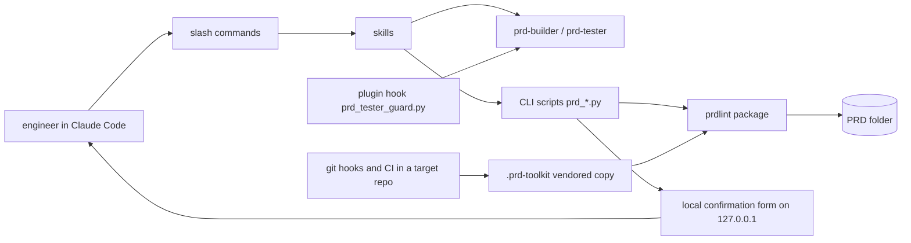

<!-- Format: references/prd-format.md, "prd.md sections". -->
<!-- The first approval goes through the prd-toolkit:authoring-prds skill (phase 7 gates); every later change and approval goes through prd-toolkit:changing-prds (step 5). -->

# prd-toolkit

## 1. Metadata & stack

- Language: Python 3.11 or later. Each CLI script (`prd-toolkit/scripts/prd_*.py`) is a uv script with an inline dependency header, run as `uv run --script <script>`.
- Framework: a Claude Code plugin (skills, agents, slash commands, a plugin hook) in the `ihistand` marketplace; script libraries pyyaml, sqlglot, openapi-spec-validator and markdown-it-py; pytest for the tests.
- Database: none.
- Hosting: the plugin is installed from the `ihistand` marketplace into each user's Claude Code; a target repository runs a vendored copy of the scripts under `.prd-toolkit/` from its git hooks and CI.
- Repository: https://github.com/ihistand/claude-plugins, folder `prd-toolkit/`. This PRD covers `prd-toolkit/` only. The repository's other plugins (`sqlanvil-toolkit`, `stl-generator-toolkit`) and the `web/` docs site are outside it, which is why the slug is `prd-toolkit` and not the repository's name.
- Not used: a network service, a database, a published Python package (target repositories run the vendored copy).
- Packaging: no build backend (`prd-toolkit/pyproject.toml` has `[tool.uv] package = false` and serves only the tests); the layout is `prd-toolkit/` with `scripts/` (the CLI scripts and the `prdlint` package), `skills/`, `agents/`, `commands/`, `hooks/`, `templates/` and `references/`; the entry points are the CLI scripts, each run as `uv run --script prd-toolkit/scripts/prd_<name>.py`; the install command is `/plugin install prd-toolkit@ihistand` after `/plugin marketplace add ihistand/claude-plugins`, and in a target repository `prd_hooks.py install docs/prd/<slug>` vendors the scripts.
- Not applicable: `contracts/openapi.yaml` — no HTTP API
- Not applicable: `contracts/schema.sql` — no database
- Not applicable: `contracts/events.md` — no events, jobs or queues
- Not applicable: `contracts/permissions.yaml` — no identities or roles
- Not applicable: `contracts/data-classification.yaml` — no stored personal data
- Not applicable: `contracts/dependencies/` — no third-party service is called; git and uv are tools on the runner (testing.md Harness), and the standards row runs the claude CLI through `npx`

## 2. Summary & goals

prd-toolkit keeps a living PRD folder in a repository and makes agents build, test and deploy
from it: a linter and trace checks for the folder, a black-box test agent, and skills that
author, adopt, change, build, deploy, handle errors in, publish and link PRDs.

Goals:

- Self-hosting: every area of the toolkit's own PRD (`adoption.md`) is `adopted`, with its characterization suite run in CI, before the plugin's version reaches 1.0.0.

Principles:

- The PRD is the authority: code implements what the PRD folder says and never defines behaviour it lacks.
- Spec-first, enforced: a behaviour change starts as a PRD change the owner approves, and the git hooks and CI refuse a commit that skips it.
- Black-box testable: every acceptance criterion has a test case a tester can write from the PRD alone, without reading the code.
- Error-Driven Development: every defect becomes an `errors.md` entry, and its fix starts from a test that fails first.
- The owner's word decides: approvals, error classes and human deploy steps are answered by the owner, never by an agent.
- Mechanical gates before judgement: lint, trace and the build checks run before any agent or person judges the work.
- The toolkit stays generic: it names no organization or platform; packs and wrapper plugins carry the specifics.

Getting started:

1. Install the plugin: `/plugin marketplace add ihistand/claude-plugins`, then `/plugin install prd-toolkit@ihistand`.
2. Start a PRD with `/prd-new`, or bring an existing repository under one with `/prd-adopt`.
3. Install the hooks once per clone: `uv run --script .prd-toolkit/prd_hooks.py install docs/prd/<slug>`.
4. Change behaviour with `/prd-change`, then build it with `/prd-build`; report a bug with `/prd-error`.

Personas: an engineer working in a repository with Claude Code; the agents the toolkit
dispatches (`prd-builder`, `prd-tester`); a reviewer reading a published PRD page.

Out of scope: the repository's other plugins and the `web/` docs site; the target projects'
own code.

## 3. Glossary

| Term | Meaning | Banned synonyms |
|---|---|---|
| PRD folder | `docs/prd/<slug>/` in a target repository: `prd.md` and the files the format reference names | spec folder |
| area | one feature file and its test-case file, bounded by the globs in its `adoption.md` row | none |
| requirement block | a `### UJ-nn`, `### FR-nnn` or `### NFR-nnn` heading and its field lines | story |
| finding | one line a check prints: `<file>:<line>: <rule>: <message>` | warning |
| rule | a named lint or trace check that produces findings | none |
| Boundary | the paths where the commit rule applies: the globs of the `adopted` rows | none |
| vendored copy | the scripts copied into a target repository's `.prd-toolkit/` by `prd_hooks.py install` | none |

## 4. Architecture

## 5. Standards registry

| Object (glob) | Linter command | Rules live in | Applies to | Decision |
|---|---|---|---|---|
| `prd-toolkit/**` | `npx -y @anthropic-ai/claude-code plugin validate ./prd-toolkit` | Claude Code's plugin manifest schema | code | enforced |

## 6. Skills registry

| Object or activity | Skill | Decision |
|---|---|---|
| a change to `prd-toolkit/skills/**` | superpowers:writing-skills | required |
| a change to the plugin's layout or manifests | superpowers-developing-for-claude-code:developing-claude-code-plugins | required |
| any code change | superpowers:test-driven-development | required |
| a bug or a failing test | superpowers:systematic-debugging | required |
| a claim that work is done | superpowers:verification-before-completion | required |
| planning a change | superpowers:writing-plans | required |
| a review of a change | code-review | recommended |

## 7. Contract types

| Type | Files (glob) | Validator |
|---|---|---|
| errors | `contracts/errors.yaml` | built-in |
| config | `contracts/config.yaml` | built-in |
| fixtures | `contracts/fixtures/**` | built-in |
| cli | `contracts/cli.yaml` | `uv run --with pyyaml python3 -c "import sys,yaml; sys.exit(0 if isinstance(yaml.safe_load(open('contracts/cli.yaml')), dict) else 1)"` |

`cli` holds one top-level key per CLI script (`prd_lint`, `prd_trace`, …): its arguments, its
output lines and its exit codes. A test case targets a script as `cli:<key>`.

## 8. Adoption map

See adoption.md.

## 9. Versioning

- Breaking for the API: a removed or renamed script or option, a changed output-line format, or a changed exit-code meaning.
- Breaking for the schema: a change that makes a PRD folder that linted clean fail lint, or drops a field or file the format accepted.
- Breaking for events: Not applicable: no events.
- Compatibility window: an old form keeps working, with a finding that names its replacement, for at least one minor version of the plugin.
- Migration rule: every format change has an upgrade note in the README changelog; a breaking one also has a lint finding that says how to fix the PRD.

## 10. Design & UI

Not applicable: command-line scripts and Claude Code skills; the published PRD page is a generated file, not a product interface.

## 11. Requirement index

| ID | Title | Status | File | Since |
|---|---|---|---|---|
| UJ-01 | An engineer lints a PRD folder and fixes what it reports | live | features/lint-cli.md | 1.0.0 |
| FR-001 | Lint a PRD folder and print its findings | verified | features/lint-cli.md |  |
| FR-002 | Name each finding's file from the working directory | live | features/lint-cli.md | 1.0.0 |
| FR-003 | List the rules | verified | features/lint-cli.md |  |
| FR-004 | Reject a bad command line | verified | features/lint-cli.md |  |
| FR-005 | Refuse a folder without prd.md | verified | features/lint-cli.md |  |
| FR-006 | Report an internal error without a traceback | verified | features/lint-cli.md |  |
| FR-007 | Sample T-ids for the dry run | verified | features/lint-cli.md |  |
| FR-008 | Mark a CI run for the rules | live | features/lint-cli.md | 1.0.0 |
| FR-009 | Write UTF-8 in any locale | live | features/lint-cli.md | 1.0.0 |
| FR-010 | Name a missing dependency | verified | features/lint-cli.md |  |
| FR-011 | Load the test-case files | verified | features/lint-cli.md |  |
| FR-012 | Load the contract YAML files | verified | features/lint-cli.md |  |
| FR-013 | List the packs | verified | features/lint-cli.md |  |
| FR-014 | Print the lint result as a JSON document | verified | features/lint-cli.md |  |
| FR-015 | Leave the PRD folder's root README out of the lint | verified | features/lint-cli.md |  |
| FR-016 | Report a Levels Timeout that is not a whole number of seconds | verified | features/lint-cli.md |  |
| FR-017 | Report an Environments Branch that git refuses | verified | features/lint-cli.md |  |
| FR-018 | Check a runbook Check's matches pattern | verified | features/lint-cli.md |  |
| NFR-019 | A test run leaves no cached uv environments behind | verified | nfr.md |  |

## 12. Assumptions index

| ID | Assumption | Status |
|---|---|---|

## 13. Open questions

None.

## 14. Changelog

| Version | Date | Change | IDs |
|---|---|---|---|
| 0.1.0 | 2026-11-03 | Draft started (adoption bootstrap) | none |
| 1.0.0 | 2026-11-03 | Approved; lint-cli area adopted; suite 29 pass, T-005.3 known-failing E-001, T-006.3 known-failing E-005, T-007.5 known-failing E-006, T-010.2 known-failing E-002, T-011.6 known-failing E-003, T-012.3 known-failing E-003, T-012.2 known-failing E-004; dry run T-004.1, T-007.1, T-007.5, T-011.1, T-011.2, 0 open questions, 0 dismissed by quote (an earlier dry run's 2 testing.md gaps were fixed) | UJ-01, FR-001, FR-002, FR-003, FR-004, FR-005, FR-006, FR-007, FR-008, FR-009, FR-010, FR-011, FR-012 |
| 1.0.1 | 2026-11-03 | §5 standards row runs `plugin validate` through `npx -y @anthropic-ai/claude-code`, so the generated CI job needs no claude CLI on the runner; §1 says so; no dry run (wording only) | none |
| 2.0.0 | 2026-11-03 | lint-cli for prd-toolkit 0.8.0: `warn` findings and an exit code that counts errors only, `--list-rules` with severities (a format change §9 calls breaking, accepted by the owner for 0.8.0), `--list-packs` (FR-013), and a one-line usage; the PRD_PLUGINS_FILE setting in contracts/config.yaml; testing.md defines the output keys, `runs`/`each_run` and in-process calls; dry run T-001.4, T-001.5, T-003.1, T-004.1, T-004.3, T-013.1, T-013.2, 0 open questions, 0 dismissed by quote (three earlier dry runs' 10 gaps fixed) | FR-001, AC-001.2, AC-001.4, AC-001.5, T-001.4, T-001.5, FR-003, AC-003.1, T-003.1, FR-004, AC-004.1, AC-004.3, T-004.1, T-004.3, FR-013, AC-013.1, AC-013.2, T-013.1, T-013.2 |
| 2.1.0 | 2026-11-03 | lint-cli FR-013: the vendored copy's `--list-packs` (its vendored packs with the sources pack-sources.json records, and its stderr note), as 0.8.0 ships it; AC-013.1 and AC-013.2 name the plugin's copy; testing.md gains the repo/vendored fixture and the stderr keys; dry run T-013.3, T-013.4, 0 open questions, 1 dismissed by quote (two earlier dry runs' 7 gaps fixed) | FR-013, AC-013.1, AC-013.2, AC-013.3, T-013.3, T-013.4 |
| 3.0.0 | 2026-11-03 | lint-cli for prd-toolkit 0.8.1: `--json` prints one `lint` JSON document (FR-014) and `--interface` prints the interface number; FR-001's line output is scoped to a run without `--json`; the one-line usage names both options (AC-004.1, a changed usage line T-004.1 and T-004.3 assert, so major); `prdlint/interface.py` joins the Boundary; testing.md gains the `stdout_json` keys; dry run T-004.1, T-004.3, T-014.1, T-014.2, T-014.3, T-014.4, T-014.5, T-014.6, T-014.7, 0 open questions, 1 dismissed by quote (an earlier dry run's 2 gaps fixed) | FR-001, AC-001.1, AC-001.2, AC-001.4, AC-001.5, FR-004, AC-004.1, T-004.1, T-004.3, FR-014, AC-014.1, AC-014.2, AC-014.3, AC-014.4, AC-014.5, AC-014.6, T-014.1, T-014.2, T-014.3, T-014.4, T-014.5, T-014.6, T-014.7 |
| 4.0.0 | 2026-11-04 | lint-cli FR-014: `--interface` wins over an unsupported `--json=<N>` (AC-014.4 no longer applies when `--interface` is given, so major; AC-014.5 says it), a gap the 0.8.1 build found; cli.yaml says it; dry run T-014.4, T-014.5, T-014.8, 0 open questions, 0 dismissed by quote | FR-014, AC-014.4, AC-014.5, T-014.8 |
| 5.0.0 | 2026-11-07 | lint-cli FR-006 for E-007: AC-006.3 widened so an entry named `<name>.yaml` in test-cases/ or under contracts/ outside contracts/fixtures/ that is not a regular file is a sufficiency finding at line 0 (`a .yaml entry that is not a file`), not an internal error (an input that exited 2 now exits 1, so major); regression tests T-006.4 and T-006.5 known-failing E-007; testing.md Tools on the runner names macOS or Linux with symbolic links and the pyproject.toml environment the Levels commands run in, two gaps the dry runs found; the STALE Source: line of FR-006 refreshed; dry run T-006.4, T-006.5, 0 open questions, 2 dismissed by quote (three earlier dry runs' 3 gaps fixed) | FR-006, AC-006.3, T-006.4, T-006.5 |
| 5.1.0 | 2026-11-07 | lint-cli FR-015 for prd-toolkit 0.8.4: lint reports no finding in the PRD folder's root README.md, which prd_block.py generates, and reads every other README.md as before (T-015.1, T-015.2, with the new fixture lint-cli/readme_markers in testing.md); §2 gains its Principles and Getting started parts; adoption.md maps 13 unmapped scripts in four not started rows (gates, change, judge, packs) and adds the 0.8.4 overview and README templates to the status row; dry run T-015.1, T-015.2, 0 open questions, 0 dismissed by quote (an earlier dry run's 1 gap fixed, 1 question dismissed by quote) | FR-015 |
| 5.2.0 | 2026-11-08 | lint-cli FR-016, FR-017, FR-018 for prd-toolkit 0.8.5: lint reports a testing.md Levels Timeout cell that is not a whole number of seconds of at least 1 (runbook-tests), an operations.md Environments Branch cell that git check-ref-format --branch refuses (runbook-env), and a runbook Check whose matches pattern does not compile or that holds both prints and matches (runbook-steps), with T-016.1, T-017.1, T-018.1 and T-018.2 on the fixture changes M2 to M5; testing.md runs the unit and integration levels with -n auto (pytest-xdist), a patch item; dry run T-016.1, T-017.1, T-018.1, T-018.2, 0 open questions, 0 dismissed by quote | FR-016, FR-017, FR-018 |
| 6.0.0 | 2026-11-09 | lint-cli FR-010 for prd-toolkit 0.8.5: prd_publish.py's dependency header gains the pinned diagram renderer mermaidx==0.11.3, so by the unchanged AC-010.2 its missing-package hint ends pip install pyyaml sqlglot openapi-spec-validator markdown-it-py mermaidx; T-010.2's expected stderr and note gain mermaidx (a changed expect, so major) and FR-010's Edge cases line names both added packages; adoption.md's publish row maps the new prdlint/diagrams.py, a patch item; dry run T-010.2, 0 open questions, 3 dismissed by quote | FR-010, T-010.2 |
| 6.1.0 | 2026-11-09 | NFR-019: a test run leaves no cached uv environments behind (test cache per worktree, E-008); dry run T-019.1, T-019.2, 0 open questions, 0 dismissed by quote | NFR-019, AC-019.1, AC-019.2, T-019.1, T-019.2 |
