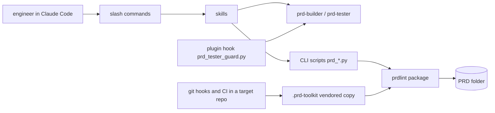

<!-- Format: references/prd-format.md, "prd.md sections". -->
<!-- The first approval goes through the prd-toolkit:authoring-prds skill (phase 7 gates); every later change and approval goes through prd-toolkit:changing-prds (step 5). -->

# prd-toolkit

## 1. Metadata & stack

- Language: Python 3.11 or later. Each CLI script (`prd-toolkit/scripts/prd_*.py`) is a uv script with an inline dependency header, run as `uv run --script <script>`.
- Framework: a Claude Code plugin (skills, agents, slash commands, a plugin hook) in the `ihistand` marketplace; script libraries pyyaml, sqlglot, openapi-spec-validator and markdown-it-py; pytest for the tests.
- Database: none.
- Hosting: the plugin is installed from the `ihistand` marketplace into each user's Claude Code; a target repository runs a vendored copy of the scripts under `.prd-toolkit/` from its git hooks and CI.
- Repository: https://github.com/ihistand/claude-plugins, folder `prd-toolkit/`. This PRD covers `prd-toolkit/` only. The repository's other plugins (`sqlanvil-toolkit`, `stl-generator-toolkit`) and the `web/` docs site are outside it, which is why the slug is `prd-toolkit` and not the repository's name.
- Not used: a network service, a database, a published Python package (target repositories run the vendored copy).
- Not applicable: `contracts/openapi.yaml` — no HTTP API
- Not applicable: `contracts/schema.sql` — no database
- Not applicable: `contracts/events.md` — no events, jobs or queues
- Not applicable: `contracts/permissions.yaml` — no identities or roles
- Not applicable: `contracts/data-classification.yaml` — no stored personal data
- Not applicable: `contracts/dependencies/` — no third-party service is called; git, uv and the claude CLI are tools on the runner (testing.md Harness)

## 2. Summary & goals

prd-toolkit keeps a living PRD folder in a repository and makes agents build, test and deploy
from it: a linter and trace checks for the folder, a black-box test agent, and skills that
author, adopt, change, build, deploy, handle errors in, publish and link PRDs.

Goals:

- [NEEDS CLARIFICATION: first measurable goal for the toolkit]

Personas: an engineer working in a repository with Claude Code; the agents the toolkit
dispatches (`prd-builder`, `prd-tester`); a reviewer reading a published PRD page.

Out of scope: the repository's other plugins and the `web/` docs site; the target projects'
own code.

## 3. Glossary

| Term | Meaning | Banned synonyms |
|---|---|---|
| PRD folder | `docs/prd/<slug>/` in a target repository: `prd.md` and the files the format reference names | spec folder |
| area | one feature file and its test-case file, bounded by the globs in its `adoption.md` row | none |
| requirement block | a `### UJ-nn`, `### FR-nnn` or `### NFR-nnn` heading and its field lines | story |
| finding | one line a check prints: `<file>:<line>: <rule>: <message>` | warning |
| rule | a named lint or trace check that produces findings | none |
| Boundary | the paths where the commit rule applies: the globs of the `adopted` rows | none |
| vendored copy | the scripts copied into a target repository's `.prd-toolkit/` by `prd_hooks.py install` | none |

## 4. Architecture

[NEEDS CLARIFICATION: confirm this picture of the components and how they connect]

## 5. Standards registry

| Object (glob) | Linter command | Rules live in | Applies to | Decision |
|---|---|---|---|---|
| `prd-toolkit/**` | `claude plugin validate ./prd-toolkit` | Claude Code's plugin manifest schema | code | proposed |

## 6. Skills registry

| Object or activity | Skill | Decision |
|---|---|---|
| a change to `prd-toolkit/skills/**` | superpowers:writing-skills | proposed |
| a change to the plugin's layout or manifests | superpowers-developing-for-claude-code:developing-claude-code-plugins | proposed |
| any code change | superpowers:test-driven-development | proposed |
| a bug or a failing test | superpowers:systematic-debugging | proposed |
| a claim that work is done | superpowers:verification-before-completion | proposed |
| a review of a change | code-review | proposed |

## 7. Contract types

| Type | Files (glob) | Validator |
|---|---|---|
| errors | `contracts/errors.yaml` | built-in |
| config | `contracts/config.yaml` | built-in |
| fixtures | `contracts/fixtures/**` | built-in |
| cli | `contracts/cli.yaml` | `uv run --with pyyaml python3 -c "import sys,yaml; sys.exit(0 if isinstance(yaml.safe_load(open('contracts/cli.yaml')), dict) else 1)"` |

`cli` holds one top-level key per CLI script (`prd_lint`, `prd_trace`, …): its arguments, its
output lines and its exit codes. A test case targets a script as `cli:<key>`.

## 8. Adoption map

See adoption.md.

## 9. Versioning

- Breaking for the API: [NEEDS CLARIFICATION: what counts as breaking for a script's arguments, output lines and exit codes]
- Breaking for the schema: [NEEDS CLARIFICATION: what counts as breaking for the PRD folder format, for example a change that makes a valid PRD fail lint]
- Breaking for events: Not applicable: no events.
- Compatibility window: [NEEDS CLARIFICATION: how long an old format or option keeps working]
- Migration rule: [NEEDS CLARIFICATION: how a format change reaches existing PRDs (an upgrade note, a patch bump with a format row in §14)]

## 10. Design & UI

Not applicable: command-line scripts and Claude Code skills; the published PRD page is a generated file, not a product interface.

## 11. Requirement index

| ID | Title | Status | File | Since |
|---|---|---|---|---|
| FR-001 | Lint a PRD folder and print its findings | as-built | features/lint-cli.md |  |
| FR-002 | Name each finding's file from the working directory | as-built | features/lint-cli.md |  |
| FR-003 | List the rules | as-built | features/lint-cli.md |  |
| FR-004 | Reject a bad command line | as-built | features/lint-cli.md |  |
| FR-005 | Refuse a folder without prd.md | as-built | features/lint-cli.md |  |
| FR-006 | Report an internal error without a traceback | as-built | features/lint-cli.md |  |
| FR-007 | Sample T-ids for the dry run | as-built | features/lint-cli.md |  |
| FR-008 | Mark a CI run for the rules | as-built | features/lint-cli.md |  |
| FR-009 | Write UTF-8 in any locale | as-built | features/lint-cli.md |  |
| FR-010 | Name a missing dependency | as-built | features/lint-cli.md |  |
| FR-011 | Load the test-case files | as-built | features/lint-cli.md |  |
| FR-012 | Load the contract YAML files | as-built | features/lint-cli.md |  |

## 12. Assumptions index

| ID | Assumption | Status |
|---|---|---|

## 13. Open questions

- Q-01 `PRD_LINT_CI=1` already in the environment, without `--ci`, has the same effect as `--ci` (the registries rule reads only the variable, and prd_error.py sets it by default). Is that intended, and who owns the setting? (FR-008)
- Q-02 `--sample-tids` compares the level with `unit` case-sensitively, so `level: Unit` is sampled, and a test case whose value is not a mapping loads with no level and is sampled. Are both intended? (FR-007)
- Q-03 A directory in the PRD folder whose name ends in `.md` makes lint exit 2 as an internal error, as a `.md` file that is not UTF-8 does. Is the directory case intended too? (FR-006)

## 14. Changelog

| Version | Date | Change | IDs |
|---|---|---|---|
| 0.1.0 | 2026-11-03 | Draft started (adoption bootstrap) | none |
