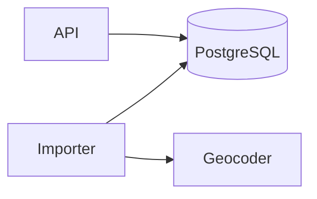

# Orders service

## 1. Metadata & stack

- Language: Python 3.12
- Framework: Starlette 0.41, served by uvicorn 0.32
- Database: PostgreSQL 16, migrations by hand-written SQL
- Hosting: Cloud Run, one service per environment
- Repository: `github.com/example/orders`
- Not used: message brokers, ORMs, front-end frameworks

## 2. Summary & goals

The orders service imports order files from the warehouse and lets sales reps look up
and admins delete orders through an HTTP API.

Goals:

- Import a 10,000-row file in under 60 seconds.
- Answer an order lookup within 300 ms at p95.
- Skip every duplicate row and log it, with zero duplicate orders stored.

Personas: a sales rep (looks up own orders) and an admin (also deletes orders).

Out of scope: order creation through the API, payments, shipping.

## 3. Glossary

| Term | Meaning | Banned synonyms |
|---|---|---|
| order | A customer's request for goods, stored once per order_key | purchase |
| customer | The person or company an order belongs to | client |

## 4. Architecture

The importer reads a file, validates postal codes with the geocoder, and writes to the
database. The API reads and deletes orders. The geocoder is the only external service.

## 5. Standards registry

| Object (glob) | Linter command | Rules live in | Applies to | Decision |
|---|---|---|---|---|
| `**/*.sql` | `python3 -m json.tool` | none; stand-in command for the fixture | code, schema.sql | enforced |

## 6. Skills registry

| Object or activity | Skill | Decision |
|---|---|---|
| plans | superpowers:writing-plans | required |

## 7. Contract types

| Type | Files (glob) | Validator |
|---|---|---|
| openapi | `contracts/openapi.yaml` | built-in |
| schema | `contracts/schema.sql` | built-in |
| events | `contracts/events.md` | built-in |
| errors | `contracts/errors.yaml` | built-in |
| permissions | `contracts/permissions.yaml` | built-in |
| config | `contracts/config.yaml` | built-in |
| classification | `contracts/data-classification.yaml` | built-in |
| dependencies | `contracts/dependencies/*.yaml` | built-in |
| fixtures | `contracts/fixtures/**` | built-in |
| lookml | `contracts/custom/*.lkml` | `python3 -c "import sys; sys.exit(0)"` |

## 8. Adoption map

Not applicable: new project.

## 9. Versioning

- Breaking for the API: removing or renaming a path, field or enum value; adding a required request field.
- Breaking for the schema: dropping or retyping a column; adding a NOT NULL column without a default.
- Breaking for events: changing the payload shape of `import_orders` or its idempotency key.
- Compatibility window: one minor version.
- Migration rule: expand, then migrate, then contract.

## 10. Design & UI

Not applicable: the service has no user interface.

## 11. Requirement index

| ID | Title | Status | File | Since |
|---|---|---|---|---|
| UJ-01 | Rep looks up an order | live | features/api.md | 1.0.0 |
| FR-001 | Import an orders file | live | features/import.md | 1.0.0 |
| FR-002 | Get an order | live | features/api.md | 1.0.0 |
| FR-003 | Delete an order | live | features/api.md | 1.0.0 |
| NFR-004 | Order lookup latency | live | nfr.md | 1.0.0 |

## 12. Assumptions index

| ID | Assumption | Status |
|---|---|---|
| A-01 | Reps see only their own orders | confirmed |

## 13. Open questions

None.

## 14. Changelog

| Version | Date | Change | IDs |
|---|---|---|---|
| 1.0.0 | 2026-10-29 | Initial release | UJ-01, FR-001, FR-002, FR-003, NFR-004 |
